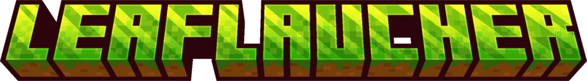

  
  
  

Leaf Launcher est un launcher Minecraft: Java Edition open source, écrit en **Rust**. Il gère
plusieurs instances à la fois, chacune avec sa version, ses mods et ses réglages, dans une
interface animée et entièrement personnalisable.

Il est bâti sur la base du [launcher Horizon](https://github.com/horizon-rust/horizon) (MIT). Ce
n'est pas un produit officiel Minecraft, ni approuvé par Mojang ou Microsoft.

## Installation

Télécharge la dernière version sur la page des
**[Releases](https://github.com/loxans2/LeafLauncher/releases/latest)**, décompresse-la et lance
`LeafLauncher.exe` (Windows 10 et 11, x64).

### Builds de développement

Chaque commit est compilé par [GitHub Actions](https://github.com/loxans2/LeafLauncher/actions),
pull requests comprises. Ces builds ne sont pas faits pour la plupart des joueurs : ils peuvent
contenir des bugs.

## Fonctionnalités

- **Toutes les versions de Mojang** : 26.3, 26.2, 26.1, 1.21.11… jusqu'aux snapshots, bêtas et
  alphas, avec le Java qui convient à chacune, téléchargé tout seul.
- **Vanilla, Fabric, Quilt, Forge et NeoForge**, à la version de ton choix.
- **Deux moteurs** : Minecraft officiel (Java), ou [Horizon](https://github.com/horizon-rust/horizon),
  Minecraft 26.3 réécrit en Rust. Un interrupteur JAVA ⇄ RUST fait passer de l'un à l'autre.
- **Bibliothèque Modrinth** : mods, packs de ressources, shaders et modpacks, installés en un clic
  avec leurs dépendances.
- **Connexion Microsoft** dans ton navigateur, comme Prism Launcher. Les comptes hors ligne marchent
  aussi.
- **Thèmes** : 12 préréglages, toutes les couleurs, un fond en aurore, dégradé, image ou particules,
  les polices, les arrondis, la taille de l'interface… Les thèmes s'exportent et se partagent.
- **Discord Rich Presence**, avec ton serveur mis en avant.
- **Sécurisé** : jetons chiffrés par Windows, fichiers vérifiés par hash, aucune télémétrie
  ([SECURITY.md](SECURITY.md)).

## Communauté et support

Ouvre une [issue](https://github.com/loxans2/LeafLauncher/issues) si tu trouves un bug ou veux
proposer une idée. Pour une faille de sécurité, suis plutôt [SECURITY.md](SECURITY.md).

Et viens jouer sur le serveur de la communauté : **`play.leafsmp.fr`**.

## Compiler

Pour compiler Leaf Launcher toi-même, suis les [instructions de compilation](BUILD.md). Pour
participer, lis le [guide de contribution](CONTRIBUTING.md).

## Forks, redistribution et builds personnalisés

Tu es libre de forker le projet, de le redistribuer et de publier tes propres builds, tant que tu
respectes la licence (c'est une obligation légale). Si tu as modifié le code, et pas seulement
empaqueté un build, merci de faire ceci par simple courtoisie :

- Indique clairement que ton fork n'est pas Leaf Launcher, et qu'il n'est ni approuvé par le projet
  Leaf Launcher ni lié à lui.
- Utilise **ta propre** application Microsoft (`LEAF_MSA_CLIENT_ID`) et **ta propre** application
  Discord, ou laisse-les vides. Le launcher compile quand même : les fonctions qui en ont besoin
  sont alors désactivées.

En compilant le launcher avec un client ID Microsoft, tu acceptes les
[conditions d'utilisation de la Microsoft Identity Platform](https://learn.microsoft.com/legal/microsoft-identity-platform/terms-of-use).

Une question sur ces conditions ? Ouvre une issue.

## Licence

Le code du launcher est sous [licence MIT](LICENSE). Les modules repris du launcher Horizon restent
sous sa licence MIT ([LICENSE-HORIZON](LICENSE-HORIZON)).

Le logo LeafLauncher et les visuels associés appartiennent à LeafStudio : ils ne sont pas couverts
par la licence MIT.

Les licences de tous les logiciels embarqués ou téléchargés par le launcher sont listées dans
[THIRD_PARTY_LICENSES.md](THIRD_PARTY_LICENSES.md), et dans le launcher (**Réglages › À propos ›
Licences open source**).

## Remerciements

Merci à [Horizon](https://github.com/horizon-rust/horizon), dont le launcher a servi de base, à
[Prism Launcher](https://github.com/PrismLauncher/PrismLauncher) pour l'inspiration, et à
[Modrinth](https://modrinth.com), [FabricMC](https://fabricmc.net), [QuiltMC](https://quiltmc.org),
[Forge](https://minecraftforge.net), [NeoForged](https://neoforged.net) et
[Tauri](https://tauri.app).

Minecraft est une marque de Mojang Studios.
